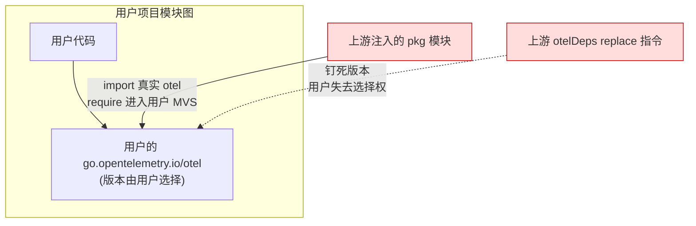
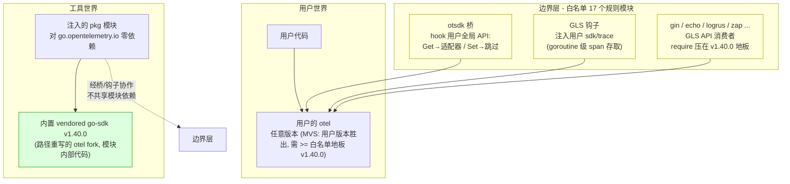
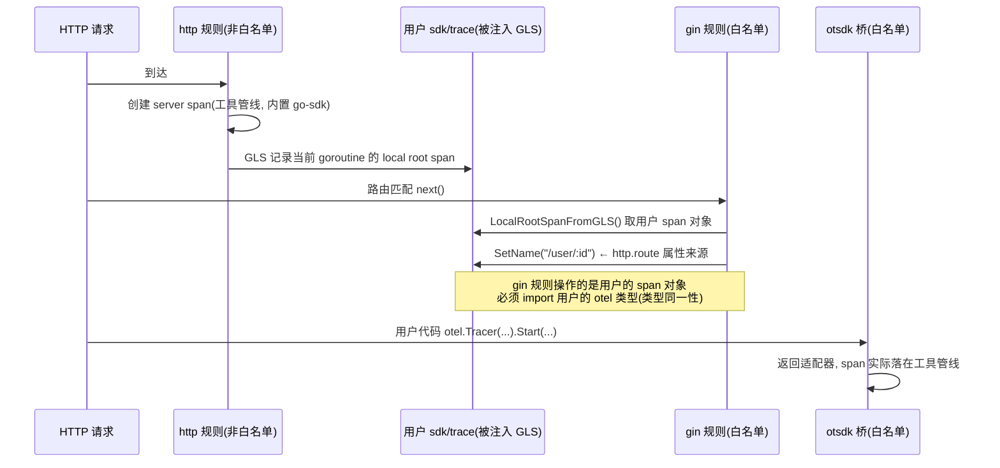
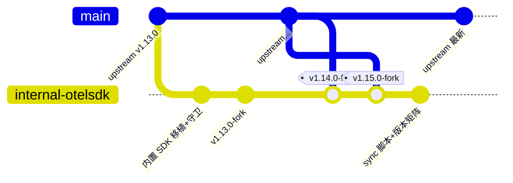

# loongsuite-go (fork)

本仓库是 [alibaba/loongsuite-go](https://github.com/alibaba/loongsuite-go) 的 fork：一个 Go 编译期
OpenTelemetry 自动埋点工具——业务代码零改动，构建时加 `otel-fork` 前缀即可完成插桩。

这个 fork 存在的唯一目的：**解决上游工具与用户项目之间的 OpenTelemetry 依赖冲突**。本分支
（`overview`）只有这一个 README，不含任何代码；代码在 `internal-otelsdk` 分支。

| Fork Tag | 对应上游 | 说明 |
|----------|---------|------|
| `v1.13.0-fork` | v1.13.0 | 内置 OTel SDK 隔离方案首次落地 |
| `v1.14.0-fork` | v1.14.0 | 第一次 tag 同步（含 neo4j 漏网 import 修复） |
| `v1.15.0-fork` | v1.15.0 | 含 sync 自动化脚本与版本矩阵回归 |

---

## 1. 上游项目是什么

[alibaba/loongsuite-go](https://github.com/alibaba/loongsuite-go) 在编译期重写用户代码与依赖包，
把 OpenTelemetry 埋点（规则）注入进去。工作目录 `.otel-build/`（点前缀，go 工具不扫描），
插桩产物以 `require + replace` 注入用户项目后编译。

## 2. 为什么需要这个 fork：上游的问题

上游注入用户项目的东西**带着对 `go.opentelemetry.io` 的真实依赖**，造成三个问题：

1. **用户模块图被污染**：注入的 pkg 模块 import 真实 otel，其 require 进入用户 MVS 图，
   陈旧 require 还会抬高用户可见的版本下限；
2. **用户 otel 版本被钉死**：上游用 `otelDeps` 这张表往用户 go.mod 写 replace 指令，把用户的
   otel 强制钉到工具指定版本——用户失去版本选择权；
3. **跨包类型不匹配**：规则模块的真实 otel import 传入编译期改写器后，与用户 otel 形成
   两套类型——上游 v1.15.0 的 neo4j 规则就因此在用户项目里编译失败。

## 3. Fork 的工作原理：双世界隔离

fork 的方案一句话：**把整套 OTel SDK 做路径重写后内置进注入模块**（`pkg/go-sdk/`，把
`go.opentelemetry.io/...` 全部改写为模块内部路径），使注入用户项目的代码对
`go.opentelemetry.io` 零依赖；用户侧的 otel 则通过一层显式边界协作，而非依赖共享。
由此形成两个互不干扰的世界：

- **工具世界**：agent 自身管线（instrumenter、exporter、指标）全部使用 `pkg/go-sdk/` 内置的
  路径重写版 otel——它是 pkg 模块的内部代码，**不参与用户模块图**，用什么版本与用户无关；
- **用户世界**：用户自己的 otel 版本原样保留，MVS 中用户版本胜出（前提 ≥ 白名单地板 v1.40.0；
  低于地板会被抬到地板——这是功能性必需：GLS 钩子只能注入 otel/sdk ≥ v1.39.0）；
- **边界层（白名单）**：必须与"用户的 otel 实例"互操作的规则——otsdk 桥把用户的全局 API
  调用接入工具管线；GLS（goroutine-local storage，goroutine 级上下文存取）钩子注入用户的
  `sdk/trace` 包；框架/日志规则读写用户路径上的 span。它们 import 真实 otel 是**设计使然**
  （类型同一性，否则跨包类型不匹配），代价是它们的 require 构成用户 MVS 地板，因此纪律是
  **版本压低**。

一次 gin 请求的 span 协作（为什么白名单必须用真实 otel）：

## 4. 分支模型与同步流程

- **`main`**：上游的严格镜像，零本地改动，只接受 fast-forward；
- **`internal-otelsdk`**：fork 的全部工作（内置 SDK 隔离改造、同步脚本、版本矩阵 demo），
  每个上游 tag 合并后打 `vX.Y.Z-fork` annotated tag（message 记录上游哈希）；
- **`overview`**：本分支，纯文档。

同步由 `scripts/sync_upstream.sh <tag>` 半自动驱动，六个阶段：镜像 main → 合并 tag
（go.mod 冲突按确定性规则自动解）→ 隔离守卫 → 构建工具 → **版本矩阵回归** → 打 tag。

版本矩阵三档断言（`example/` 下的 demo，从产物二进制的模块元数据读实际链接版本）：

| Demo | 场景 | 断言 |
|------|------|------|
| grpc-demo | 无 otel 项目 | 注入的 otel 恰好等于地板（stdlib log → golog 规则级联是上游设计） |
| otel-low-demo | otel v1.31.0（低于地板） | 被抬到 ≥ v1.39.0（GLS 硬下限），超过 v1.40.0 报警告 |
| otel-high-demo | 最新 otel | 用户版本胜出；地板追上 pin 时自动升级 demo 到最新 |

## 5. 内置 otelsdk 升级指南

先分清两个"版本"：

- **vendored 基线**（`pkg/go-sdk/`，当前 v1.40.0）：工具自身管线用的 otel，**不参与用户 MVS**，
  升级它对用户完全无感；
- **用户地板**（白名单规则的 otel require）：参与用户 MVS 的下限，应保持低位。

升级 vendored 基线：改 `scripts/vendor_otel_fork.sh` 钉死的版本后重跑（机械操作），配套版本
一起对齐：prometheus exporter v0.61.0、contrib runtime v0.65.0、proto/otlp v1.9.0。

什么时候该升级（三类触发）：
1. **安全修复（刚性）**——exporter 是运行时网络通道；当前 v1.40.0 命中 CVE-2026-29181
   （baggage DoS，v1.41.0 修复）与 GO-2026-5426（v1.43.0 修复），建议尽快升到 ≥ v1.45.0；
2. **上游同步硬需求**——上游新代码 import 了新 semconv/API 目录时不升编译不过；
3. **特性开发需要**——需要新 semconv 约定或新 SDK API 时。

不追新：基线越稳，与上游的 diff 越小，每次同步成本越低。

**当前已知待办**：白名单地板在 v1.15.0 合并时被上游抬到了 v1.45.0（15 个模块），待压回
v1.40.0——版本矩阵的软警告会持续暴露它。
